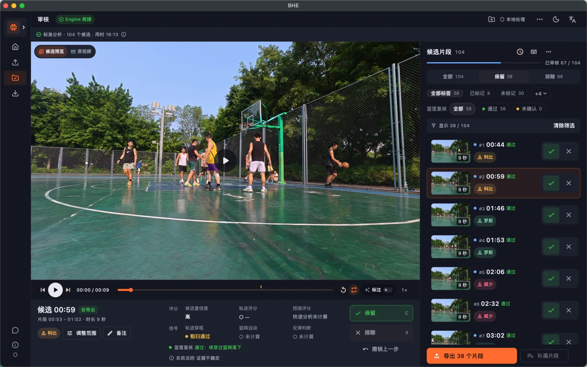
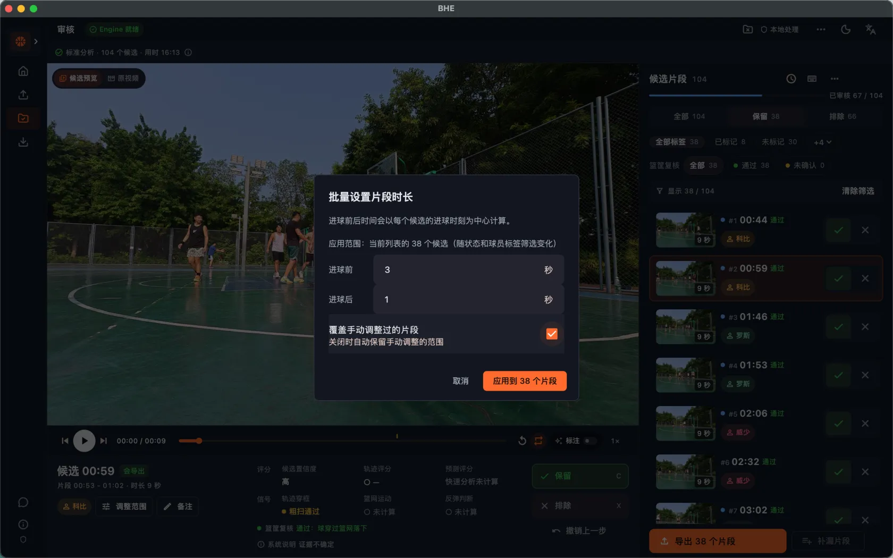
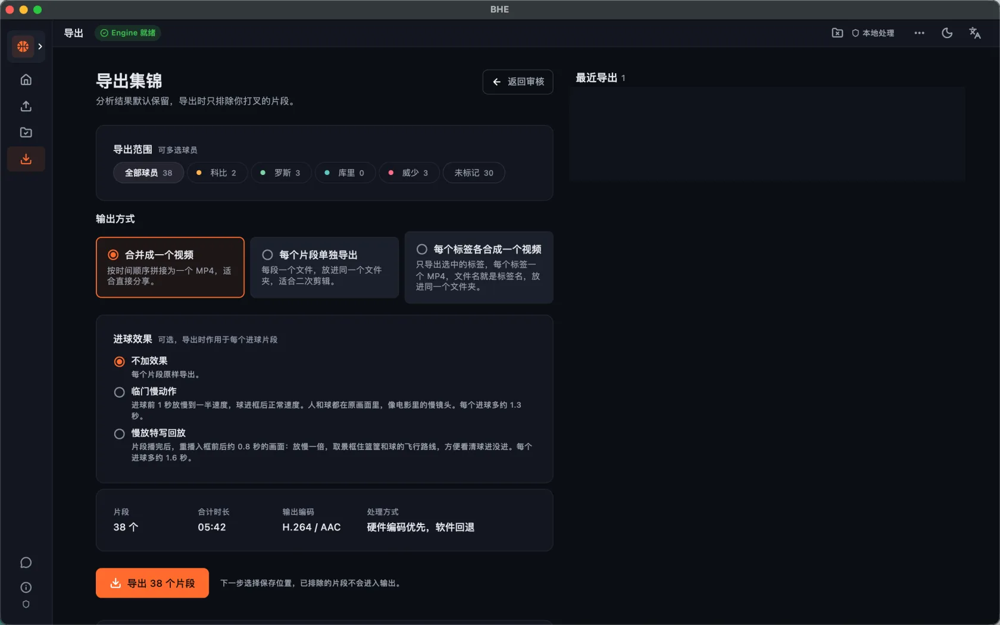
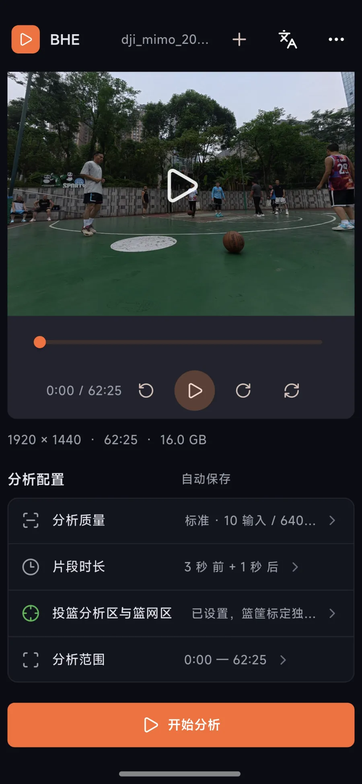
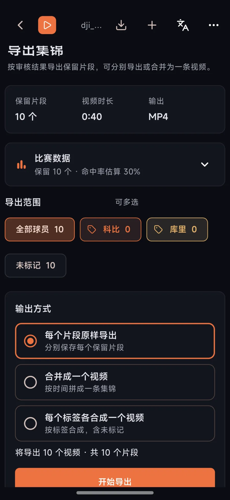

# BHE: Basketball Highlight Editor

BHE 是一个篮球集锦工具。导入固定机位拍摄的比赛录像，它找出疑似进球片段，你快速审核后导出集锦。

打完球，别再剪到半夜。一两个小时的录像，要从头拖进度条找进球，再一个个截出来。

BHE 在自己的电脑或安卓手机上分析，先把疑似进球排好队，你只需排除误检。免费、本地运行，原视频不上传。

**简体中文** · [English](README.en.md)

[官网](https://bhe.jafir.top) · [下载](#下载) · [快速上手](#快速上手) · [功能](#亮点专业高效) · [常见问题](#常见问题) · [文档](#文档)

[观看操作演示](https://github.com/user-attachments/assets/43bfed76-bbc6-42c2-bbaa-ea2bf0604292) · [备用视频](https://shengshengniannian.oss-cn-beijing.aliyuncs.com/shengshengniannian/basketball-highlight-editor/recording-demo.mp4)

## 亮点：专业、高效

- **快捷键加倍速**：1.5× / 2× 播放，↑↓ 切换片段，←→ 快退快进，X 排除，1–9（第 10 位起用 Q）标记球员，Cmd/Ctrl+Z 撤销。
- **标签分组**：保存球员和标签分组，下次项目直接导入。
- **补漏与时间调整**：从原视频添加漏掉的片段；默认进球前 3 秒、后 1 秒，可全局或单独调整。
- **按标签导出**：选择球员或标签，合并成一个视频、每个片段单独导出，或每个标签各合成一个视频。

通常用建议的篮筐区域即可，识别不准时再调整。电脑端可选慢动作；比赛数据为估算，仅供参考。

## 下载

当前版本：[v0.1.13](https://github.com/fly7632785/basketball-highlight-editor/releases/tag/v0.1.13)。也可从[官网](https://bhe.jafir.top/#download)或 [GitHub Releases](https://github.com/fly7632785/basketball-highlight-editor/releases)下载。

| 系统 | v0.1.13 安装包 | 说明 |
|---|---|---|
| macOS | [Apple 芯片](https://github.com/fly7632785/basketball-highlight-editor/releases/download/v0.1.13/BHE-macos-arm64-v0.1.13-adhoc.dmg) · [Intel](https://github.com/fly7632785/basketball-highlight-editor/releases/download/v0.1.13/BHE-macos-x86_64-v0.1.13-adhoc.dmg) | 首次打开时右键选择「打开」。 |
| Windows 10 / 11 | [x64 .zip](https://github.com/fly7632785/basketball-highlight-editor/releases/download/v0.1.13/BHE-windows-x64-v0.1.13.zip) | 下载后解压；安装与兼容性见[说明](docs/GETTING_STARTED.md)。 |
| Android | [arm64-v8a .apk](https://github.com/fly7632785/basketball-highlight-editor/releases/download/v0.1.13/BHE-android-arm64-v8a-v0.1.13-debug-signed.apk) | 侧载测试包，需允许安装未知来源应用。 |

骁龙 8 至尊版第五代手机分析 10 分钟视频约需 4.5 分钟；其他设备耗时不同，参见下方 v0.1.9 更新说明。iPhone 当前可播放、审核和导出，不能分析。

## 快速上手

1. 下载并打开 BHE。
2. 新建项目，选择比赛视频；电脑端支持同一场比赛的多段视频。
3. 确认分析范围和篮筐区域，选择标准或快速分析并开始。
4. 审核候选：排除误检、补漏并标记球员或标签。
5. 选择导出范围和输出方式，生成集锦。

## 界面截图

电脑端：

 

安卓手机：

 

## 适合什么视频

固定机位、篮筐清晰、一次拍摄一个篮筐的视频更适合；弧顶约 45° 或场边 Logo 附近可作为机位参考。全场双篮筐、频繁移动的机位和长时间遮挡不属于当前理想场景。

## 常见问题

- **需要联网吗？** 分析、审核和导出在本地进行；下载软件和查看文档需要网络。
- **免费吗？** 源码按 MIT 协议提供，不按时长或次数收费；模型和素材须遵守各自许可。
- **识别不准怎么办？** 排除误检、调整范围，或手动补上漏掉的片段。
- **iPhone 和全场视频支持吗？** iPhone 尚不能分析；当前一次处理一个篮筐，不支持双篮筐全场识别。

## 最近更新

项目完整改动见 [CHANGELOG](CHANGELOG.md)。Windows 一键更新从 `v0.1.12-windows.1` 起提供，首次需手动替换。

| 版本 | 日期 | 主要更新 |
|---|---|---|
| v0.1.13 | 2026-10-28 | 安卓新增项目列表（打开、重命名、删除、关闭项目）、导出页输出方式三选一（含每个标签各合成一个视频）、比赛数据、导出历史和导出前未标标签提醒，撤销移入菜单；安卓分析前可选择球员分组并勾选出场名单，支持编辑分组、最多 20 步审核撤销、球员标签重命名和删除；新增反馈与诊断、任务停止状态提示和更清楚的错误提示，分析与导出不能同时进行；合并导出可合并重叠片段并显示减少数量，分别导出改为逐个处理，可能更慢；修复部分视频导出失败、视频找回、项目包路径安全和竖拍导出方向，原视频校验失败时保留已有审核；桌面不加进球效果时合并同一视频的重叠片段，审核列表显示已调整和重叠标记；Windows 提前检查分析引擎；诊断信息更完整，以后各平台可单独更新补丁 |
| v0.1.12-windows.1 | 2026-10-26 | Windows 修复包：加入一键安装更新与旧版本回退保护，首次需手动替换；修复未知音轨导致的导出失败；包含最新球员分组编辑和导入名单选择功能 |
| v0.1.12-macos.2 | 2026-10-26 | macOS 导出热修复：跳过无法识别的音轨，修复普通导出报 FFmpeg 退出码 234；正常音轨继续保留，覆盖分段、合并及手动片段导出 |
| v0.1.12 | 2026-10-26 | 导出可选进球效果：临门慢动作或慢放特写回放；导出页显示比赛数据（命中率估算、每人进球、进球时间分布），可按标签各合成一个视频；默认片段改为进球前 3 秒、后 1 秒；Windows 可用显卡分析，Mac 改用 CoreML，分析更快；修复 Windows 上竖拍视频画面错位、iPhone 视频头下脚上，导出不写扩展名失败，以及部分 Windows 电脑无法分析或新建项目 |
| v0.1.11 | 2026-10-23 | 桌面端和安卓可以在 App 里检查更新，下载后校验安装包再安装；反馈入口可一键复制诊断信息，出错时能直接反馈；运行日志记录运行环境、视频参数、各阶段耗时和失败原因；安卓安装包固定签名，以后可以直接覆盖升级；修复多段项目审核页无法播放视频 |
| v0.1.10 | 2026-10-23 | 桌面端一个项目可以放同一场比赛的多段视频，按录制时间排序、排队逐段分析、合在一起审核和导出；单独导出的片段文件名带球员名；球员名单可以存成分组在其他项目一键导入；桌面端运行日志写入固定目录，可从「关于」打开；修复中文 Windows 分析卡在 1% 和 iPhone 空间音频视频导出失败 |
| v0.1.9 | 2026-10-22 | Android 在骁龙 8 至尊版第五代上用 NPU 分析，10 分钟视频约 4.5 分钟；Android 加入篮筐逐帧复核和粗扫兜底候选，结果与桌面端对齐；机位中途偏移不再漏掉后半段进球；手机审核支持按复核结果和球员筛选、时间轴范围编辑，首页显示项目封面 |
| v0.1.8 | 2026-10-21 | 篮筐复核改为只按看到的证据排除，三个已审核视频上漏判从 47 个降到 0 个；审核列表可按复核结果筛选；Windows 生成代理用显卡解码、导出用显卡编码；修复 Windows 非 16:9 视频四周黑边和浅色主题文字看不清 |
| v0.1.7 | 2026-10-20 | 标准分析新增篮筐逐帧复核，自动排除没进的候选；首页支持拖入视频新建项目并显示项目封面；重做片段范围编辑，数字键快速设置球员标签；修复一批审核和导出的卡顿与状态问题 |
| v0.1.4 – v0.1.6 | 2026-10-17 | 审核视频铺满面板；修复 Windows 发布包的代理生成和导出，之后 10-18 至 10-20 又发布了多个 Windows 热修复 |
| v0.1.1 – v0.1.3 | 2026-09-16 – 09-23 | 桌面端和移动端完整中英文界面；修复 Android 原生库加载和 ONNX Runtime 版本 |
| v0.1.0 | 2026-09-14 | 首个正式预览版：自动构建 macOS、Windows 安装包和 Android 测试包，可从官网下载；移动端完成桌面算法移植 |

## 支持与交流

如果对您有帮助，请作者喝杯咖啡

### BHE 用户交流群

扫码加微信，备注「进群」。

## 文档

- [用户流程](docs/USER_FLOW_V1.md) · [开发说明](docs/DEVELOPMENT.md) · [架构](docs/architecture/ARCHITECTURE_V1.md) · [移动端能力](docs/MOBILE_PC_FEATURE_MATRIX.md)
- [反馈问题](https://github.com/fly7632785/basketball-highlight-editor/issues) · [官网](https://bhe.jafir.top)
- 隐私与授权：视频默认本地处理；源码、模型、素材及第三方依赖许可不同，参见 [授权说明](docs/MODEL_AND_DATA_LICENSES.md) 和 [第三方清单](docs/THIRD_PARTY_NOTICES.md)。
- 感谢 [Linux.do](https://linux.do/) 社区及所有贡献者。

更多原有参考链接：[`docs/USER_FLOW_V1.md`](docs/USER_FLOW_V1.md) · [`docs/README.md`](docs/README.md) · [`docs/RELEASE.md`](docs/RELEASE.md) · [`apps/mobile/README.md`](apps/mobile/README.md) · [`docs/MOBILE_PC_FEATURE_MATRIX.md`](docs/MOBILE_PC_FEATURE_MATRIX.md) · [`CHANGELOG.md`](CHANGELOG.md) · [`docs/architecture/`](docs/architecture/) · [用户流程](docs/USER_FLOW_V1.md) · [产品需求](docs/REQUIREMENTS_V1.md) · [决策记录](docs/DECISIONS_V1.md) · [架构说明](docs/architecture/ARCHITECTURE_V1.md) · [Engine 协议](docs/architecture/ENGINE_PROTOCOL_V1.md) · [SQLite 结构](docs/architecture/SQLITE_SCHEMA_V1.sql) · [macOS 打包](docs/RELEASE.md) · [审核数据导出](docs/REVIEW_DATASET_EXPORT.md) · [性能基准](docs/benchmarks/ANALYSIS_MODE_BENCHMARK_20260812.md) · [HoopCut](https://github.com/RuiYang0122/HoopCut) · [basketball-highlights](https://github.com/reborncd/basketball-highlights) · [ShotMarker](https://github.com/zhangrunhao/ShotMarker) · [basketball_clipper](https://github.com/snowroll/basketball_clipper) · [ball-yolo](https://github.com/griftt/ball-yolo) · [ClarkWang1214/basketball-highlights](https://github.com/ClarkWang1214/basketball-highlights) · [ai-sports-cut-agent](https://github.com/bond0060/ai-sports-cut-agent) · [`docs/MODEL_AND_DATA_LICENSES.md`](docs/MODEL_AND_DATA_LICENSES.md) · [`docs/THIRD_PARTY_NOTICES.md`](docs/THIRD_PARTY_NOTICES.md)
